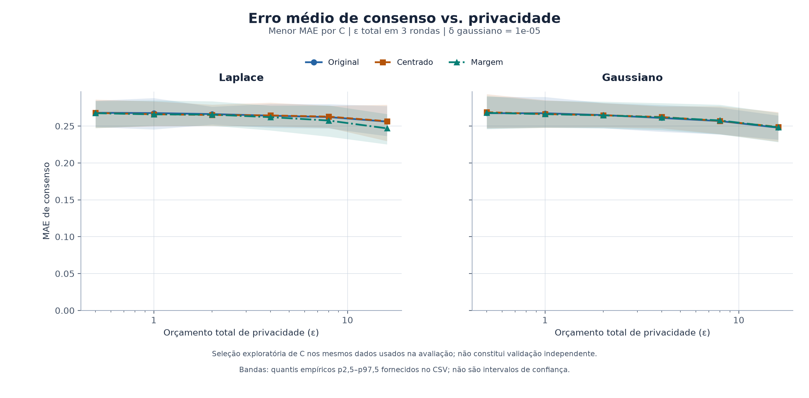
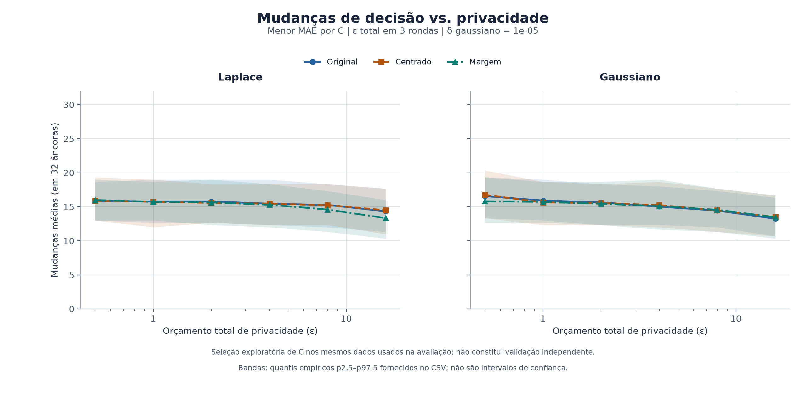
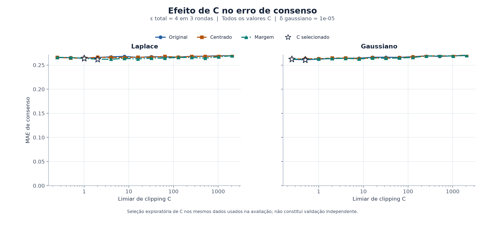

# 6.2 — Experiências de LDP nos logits

## Resultado principal

As experiências foram feitas sobre os **logits já guardados**, sem treinar modelos e sem usar dev ou test. Na melhor configuração observada para `ε total = 4`, o consenso privado diferiu do consenso original em **MAE médio de 0,261** e mudou, em média, **15,0 das 32 decisões** por ronda. Portanto, nesta experiência, mesmo as opções de menor erro causaram uma alteração considerável. Não há base aqui para dizer que a deteção clínica melhorou ou piorou.

O estudo é exploratório. As diferenças entre algumas opções são menores do que a variabilidade das simulações, e as opções foram escolhidas nos mesmos logits em que foram avaliadas. Elas servem como **candidatas a um teste posterior**, não como vencedoras clínicas nem como prova de que o sistema completo oferece LDP.

## Dados e protocolo

Foram usados os arquivos `teacher_round_1.npz`, `teacher_round_2.npz` e `teacher_round_3.npz` em:

```text
SoftLabels tests/final candidates/artifacts/confirmation/
A_AE_CNN__MobileNetV2/2031/
```

O código é da branch pública `testing-models`, commit `9c4bdea`. São os arquivos da candidata **A**, conforme solicitado, mesmo que a decisão registada noutro ponto do repositório tenha escolhido posteriormente a candidata B. Em cada ronda, o array contém 22 clientes × 32 âncoras sintéticas × 2 classes. As classes são 0 = normal e 1 = anomalia.

Para reconstruir o protocolo original, aplicou-se softmax por cliente e âncora, com temperatura 1, e depois uma média **ponderada** das probabilidades. Foram respeitados os pesos dos NPZ: 16 clientes Icentia11k com peso 1/32 cada e seis PhysioNet com peso 1/12 cada. Cada conjunto contribui com 50% do consenso. Os três consensos foram verificados contra os valores guardados antes da experiência.

Não se leram rótulos clínicos, previsões dev/test nem ECGs para esta análise. A classe do consenso original era anomalia para as 32 âncoras em cada uma das três rondas. Essas âncoras são sintéticas e o consenso é um **alvo suave**, não uma previsão clínica validada.

## Desenho das experiências

Foram comparados ruído Laplaciano e Gaussiano e três representações: logits originais, logits centrados por âncora, e margem binária `logit_1 - logit_0`. A centralização e a margem preservam a softmax antes de aplicar recorte e ruído. Cada cliente é recortado conjuntamente nas suas 32 âncoras: L1 para Laplace, L2 para Gaussiano. Para substituir arbitrariamente o vetor inteiro de um cliente, a sensibilidade máxima considerada é `2C`.

Foram testados seis valores de orçamento **total para três rondas**: `ε = 0,5; 1; 2; 4; 8; 16`. A composição simples distribui `ε/3` por ronda. Em Laplace, `δ=0`; em Gaussiano, usou-se `δ total = 10⁻⁵`, dividido pelas três rondas. O Gaussiano usa calibração analítica; as duas famílias não têm garantias idênticas só por terem o mesmo ε, porque os valores de δ diferem.

Para cada mecanismo, representação e ε, foram experimentados 14 limites `C`, de 0,25 a 2.048. No total são **504 configurações**, cada uma avaliada nas três rondas com **200 sorteios independentes de ruído por ronda**. Os resultados apresentados são médias sobre as rondas e os sorteios. Os quantis nos gráficos descrevem a dispersão produzida pelo ruído nesses logits fixos; **não são intervalos de confiança clínicos**.

A escolha de C e do método foi feita pelo menor MAE do consenso nos mesmos dados. É seleção exploratória; escolher C ou divulgar diagnósticos a partir de dados privados pode exigir proteção e contabilização adicionais.

## Comparação por orçamento

A tabela seguinte mostra, para cada ε, a configuração com menor MAE médio do consenso entre as testadas. `Alterações` é o número médio de decisões diferentes, entre as 32 âncoras, por ronda. `δ` do Gaussiano é `10⁻⁵`; o de Laplace é zero.

| ε total | Mecanismo | Representação | C | MAE do consenso | MSE do consenso | Alterações / 32 |
|---:|---|---|---:|---:|---:|---:|
| 0,5 | Laplace | margem | 0,25 | 0,2674 | 0,0864 | 15,99 |
| 1 | Laplace | margem | 0,5 | 0,2658 | 0,0852 | 15,73 |
| 2 | Gaussiano | margem | 0,25 | 0,2645 | 0,0842 | 15,45 |
| 4 | Gaussiano | original | 0,5 | 0,2610 | 0,0838 | 15,02 |
| 8 | Gaussiano | original | 1 | 0,2568 | 0,0814 | 14,44 |
| 16 | Laplace | margem | 32 | 0,2468 | 0,0774 | 13,34 |

A descida do erro com ε maior é acompanhada de **menor proteção formal**, por isso não se deve escolher automaticamente a última linha. Além disso, esses números são apenas uma comparação com o consenso anterior, não com rótulos verdadeiros.





## Três opções ilustrativas para a arquitetura final

Para tornar a comparação concreta, a tabela seguinte fixa **ε total = 4**. É um valor ilustrativo escolhido para comparar opções no mesmo orçamento, não uma recomendação de segurança. As três linhas são as melhores combinações distintas de mecanismo e representação segundo o MAE médio do consenso. A tabela completa, com três opções para cada ε, está em `resultados/top3_por_epsilon.csv`.

| Opção | Representação | C | ε por ronda | δ total | MAE do consenso | Erro-padrão MC do MAE | Mudanças / 32 |
|---|---|---:|---:|---:|---:|---:|---:|
| Gaussiano | original | 0,5 | 1,3333 | 0,00001 | 0,260969 | 0,000688 | 15,02 |
| Gaussiano | margem | 0,5 | 1,3333 | 0,00001 | 0,261715 | 0,000679 | 15,09 |
| Laplace | margem | 2 | 1,3333 | 0 | 0,262069 | 0,000638 | 15,30 |

As diferenças de MAE entre essas três opções são pequenas perante a incerteza Monte Carlo e a escolha do menor erro entre múltiplas configurações. **Não há evidência aqui para afirmar que uma é realmente superior às outras.** Todas recortaram 100% dos clientes nestas três rondas e alteraram quase metade das decisões do consenso. As opções merecem, no máximo, nova avaliação controlada antes de serem integradas.

No caso Gaussiano/original, `C=0,5` e `ε total=4`, a alteração média absoluta das probabilidades individuais foi 0,473, considerando os 704 pares cliente–âncora por ronda. Mudaram em média 344,5 das 704 decisões locais, aproximadamente 48,9%. Esta contagem também é concordância com a saída não perturbada, não é recall nem FAR.

### Exemplo por ronda: Gaussiano, original, C = 0,5 e ε total = 4

| Ronda | MAE nas probabilidades locais | MAE do consenso | MSE do consenso | Decisões alteradas / 32 |
|---:|---:|---:|---:|---:|
| 1 | 0,4536 | 0,1792 | 0,0412 | 15,32 |
| 2 | 0,4810 | 0,2704 | 0,0868 | 15,26 |
| 3 | 0,4845 | 0,3334 | 0,1235 | 14,49 |

Como o consenso original destas 32 âncoras era sempre classe 1, todas as mudanças do consenso nesta tabela foram de **anomalia para normal** em relação ao consenso anterior. Isso não significa falsos negativos clínicos: faltam os rótulos reais das âncoras.

## Efeito do clipping

Foi incluído um controlo com clipping, mas **sem ruído**. Esse controlo não é privado. Para Laplace com logits centrados e `C=32`, recortaram-se 21/22 clientes na primeira ronda e 22/22 nas outras duas. O MAE médio do consenso causado somente pelo clipping foi, respetivamente, **0,0801**, **0,1462** e **0,1823**. Não houve mudanças de `argmax` nas decisões locais ou no consenso desse controlo específico; as probabilidades, no entanto, mudaram.

O clipping e o ruído exercem efeitos diferentes. `somente_clipping.csv` permite quantificar o primeiro; `por_ronda.csv` contém o efeito total por configuração. Não se deve somar diretamente os MSE de clipping e de ruído como se fossem necessariamente independentes após a softmax.



## O que pode e não pode ser concluído

**PR-AUC, recall e FAR após LDP não podem ser calculados com estes três NPZ**, porque as 32 âncoras não têm os rótulos verdadeiros necessários. As métricas dev guardadas noutras pastas referem-se ao modelo histórico sem este ruído e não podem ser reutilizadas como se medissem a nova LDP. A avaliação dessas métricas precisa de um teste posterior adequado na arquitetura final e nos dados de avaliação autorizados.

As rondas 2 e 3 foram originalmente produzidas a partir de um aluno treinado sem esta LDP. Acrescentar ruído aos NPZ agora não recalcula esse aluno nem as mensagens subsequentes. Assim, o estudo mede **o efeito do canal de ruído sobre retratos históricos**, não o comportamento de um ciclo federado completo com feedback privado.

A garantia matemática do mecanismo refere-se, sob pressupostos, à mensagem de um cliente por ronda. O histórico de pré-processamento deve ser revisto: algumas normalizações foram calculadas a partir de dados de treino agregados de vários clientes e podem fazer com que alterar um cliente afete mensagens de outros. A composição de todas as mensagens, tentativas, métricas e seleção de parâmetros tem de ser considerada. A identidade e a participação dos clientes não ficam ocultas automaticamente.

Os logits brutos usados aqui já constam do repositório. Aplicar LDP agora **não protege retroativamente divulgações anteriores**. A simulação usa um gerador NumPy e uma semente pública para ser reproduzível; portanto, o código **não é adequado para proteger dados clínicos em produção**. É necessário usar mecanismos e aleatoriedade auditados, um contabilizador apropriado, comunicação segura e análise dos restantes canais de saída. As tabelas e gráficos que comparam com logits originais também não são automaticamente DP quando os dados subjacentes são confidenciais.

## Ficheiros para o relatório e reprodução

- [Tabela completa por configuração](resultados/resumo.csv)
- [Resultados por ronda](resultados/por_ronda.csv)
- [Controlo de clipping sem ruído](resultados/somente_clipping.csv)
- [Três opções exploratórias por ε](resultados/top3_por_epsilon.csv)
- [Detalhes da configuração e hashes das fontes](resultados/configuracao.json)
- [Instruções, fórmulas e execução](README.md)

A implementação analítica do Gaussiano foi guiada por Balle e Wang, [Improving the Gaussian Mechanism for Differential Privacy](https://proceedings.mlr.press/v80/balle18a.html). Os pressupostos de sensibilidade e composição devem ser verificados para a arquitetura final, não apenas para esta experiência.
